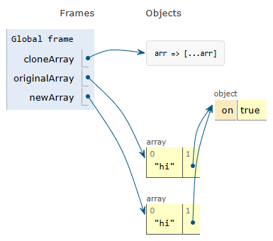

# Learning Path: Functional Programming in JavaScript #
## Section 1: Deep Dive into Functional JavaScript ###
### The Course Overview ###
1. ES2017
2. The Course Overview
	1. Introduction - principles
		1. Writing in pure functional style
	2. ES6
	3. Concepts
	4. Higher Order Functions in JS
		1. Data structures
		2. Arrays
		3. Spread and Rest
	5. Currying and Partial Evaluation
	6. Recursion, Tail Recursion, and Accumulator variables
		1. Iterative solution makes recursive solution more efficient.
	7. Summary and Outlook
3. Goals of the course:
	1. Write maintainable code
	2. Learn the principles of functional programming
	3. Get hands on problem solving experience
4. Prerequisites
	1. Principles of functional programming by example
	2. ES6 and functional programming
	3. Higher order functions
	4. Currying and partial evaluation
	5. Recursion, Tail Call optimization

### Imperative and Declarative Programming by Example ###
1. Topics:
	1. Functional programming by example
		1. Different thought process
	2. Principles of writing code in functional style
		1. Why is immutability important?
		2, JS implementation
	3. Benefits and drawbacks of functional programming
	4. Comparing functional programming to object-oriented programming
	5. Generalizing the difference between the two approaches
	6. Example - Invoice class
		1. Construct invoices with a given invoice number
		2. Add products to the invoice
		3. Get the billed sum
	7. OOP
		1. Instances and properties
		2. Getters, Setters
2. Higher-order function
	1. It either accepts a function argument or returns a function (or both)
		1. Functional programming lets the higher-order functions take care of the actual computations.
3. Example: invoice.js

```javascript
class Invoice {
    constructor(invoiceNumber) {
        this.invoiceNumber = invoiceNumber;
        this.items = [];
    }

    addItem(quantity, itemPrice, description) {
        this.items.push({quantity, itemPrice, description});
    }

    get sum() {
        let sum = 0;
        for ( let i = 0; i < this.items.length; i++) {
            let item = this.items[i]
            sum += item.quantity * item.itemPrice;
        }
        return sum;
    }
}

const invoice1 = new Invoice(1);
const invoice2 = new Invoice(2);

invoice1.addItem(2, 10, 'T-Shirt');
invoice1.addItem(3, 25, 'Bag');

invoice2.addItem(10, 1, 'Light bulb');
invoice2.addItem(2, 10, 'Pillow');

console.log('Invoice1 sum:', invoice1.sum);
console.log('Invoice2 sum:', invoice2.sum);
```

```javascript
function createInvoice(invoiceNumber) {
    return {
        invoiceNumber,
        items: []
    }
};

function clone(o) {
    return JSON.parse(JSON.stringify(o));
}

function addItem(invoice, quantity, itemPrice, description) {
    const newInvoice = clone(invoice);
    newInvoice.items.push({
        quantity,
        itemPrice,
        description
    });
    return newInvoice;
}

function calculateSum(invoice) {
    const reducer = (acc, item) => acc + item.quantity * item.itemPrice;
    return invoice.items.reduce(reducer, 0);
}

invoice1a = createInvoice(1);
invoice2a = createInvoice(2);

const invoice1b = addItem(invoice1a, 2, 10, 'T-Shirt');
const invoice1 = addItem(invoice1b, 3, 25, 'Bag');

const invoice2b = addItem(invoice2a, 10, 1, 'Light bulb');
const invoice2 = addItem(invoice2b, 2, 10, 'Pillow');

console.log('Invoice1 sum:', calculateSum(invoice1));
console.log('Invoice2 sum:', calculateSum(invoice2));
```

4. Imperative and Declarative Programming
	1. Imperative programming
		1. Example: OOP
		2. Focus on HOW
			1. Describe solution in a step by step fasion
		3. Stateful
		4. We can mutate state
			1. Methods mutate
		5. Often rely on side-effects
	2. Declarative programming
		1. Example: Functional programming
		2. Focus on WHAT (not how)
		3. Stateless
		4. Constants, immutability
			1. No variables
		5. No Side-effects

### Principles of Writing Code in Functional Style ###
1. http://tinyurl.com/packt-paradigms - classification of paradigms
2. Side-Effects
	1. Each statement has a main effect
		1. Example: Let a = 3 + 2
	2. Statements may have side-effects
		1. Example: Let b = a++;
			1. Main effect: the value of a gets assigned to b
			2. Side effect: The value of a gets incremented by 1
				1. This must be avoided in functional programming
3. Examples:

```javascript
const basket = []; // only reference cannot be changed

function addElement(
    itemName,
    itemPrice 
) {
    // main effect: Returns undefined
    // side effect: adds object to basket
    basket.push({
        itemName,
        itemPrice
    })
}

addElement('Biscuit', 1);

console.log(basket);
```

```
const basket = [];

function addElement(
    basket,
    itemName,
    itemPrice
) {
    return basket.concat([{
        itemName,
        itemPrice
    }]);
}

const basket1 = addElement(
    basket,
    'Biscuit',
    1
);

console.log(basket1);
```

4. Pure functions
	1. Functions without side-effects
		1. Immutability
			1. Cannot add, delete, or update objects
5. For true immutability: immutable.js (library that gives truly immutable datastructures)
6. Programming in Functional Style in Javascript
	1. Break down the problem using functional decomposition (smaller functions)
	2. Recursion instead of loops
	
	```javascript
	function mapScoresToGrades(tests, average) {
		if (tests.length === 0) return [];
		const head = tests[0];
		const tail = tests.slice(1);
		return [head >= average ? 'A' : 'F'].concat(
			mapScoresToGrades(tail, average)
		);
	}

	function gradetests(tests) {
		const average = getAverage(tests);
		return mapScoresToGrades(tests, average);
	}
	```
	
	3. Higher order functions
		1. Takes a function or returns a function

		```javascript
		function mapScoresToGrades(tests, average) {
			let gradeTest = function (testScore) {
				return testScore >= average ? 'A' : 'F';
			}
			return tests.map(gradeTest);
		}

		function getAverage(tests) {
			return tests.reduce( function (acc, elem) {
				return acc + elem;
			}) / tests.length;
		}

		function gradetests(tests) {
			const average = getAverage(tests);
			return mapScoresToGrades(tests, average);
		}
		```

	4. Functional JavaScript constructs
	5. Currying and partial evaluation

### Benefits and Drawbacks of Functional Programming ###
1. Topics:
	1. Advantages and disadvantages of functional programming
	2. Techniques to offset the disadvantages
2. Benefits and drawbacks of functional programming
	1. Benefits
		1. Testability
			1. Arg list determines return value
				1. No setting up external context
				2. No test setup
			2. Execution
				1. Prepare a lookup table with inputs and outputs (map)
					1. The inputs are based on the specification
					2. Inputs and outputs should include boundary values of the state space
			3. For impure functions, external context would influence the return value of our functions
				1. Needs setting up external context to determine the function behavior under a given set of conditions.
		2. Easy maintenance
			1. Easier to understand (read and interpret) without comments
			2. It is more compact than object oriented code
				1. Focuses on what problem the code solves instead of how it is solved with exact steps (we thing at a higher level)
		3. Reusable building blocks
			1. Pure functions can often be reused in the application
				1. Pieces of functionality common is the code-base can be extracted
		4. Parallel execution
			1. When using pure functions, the order of execution does not matter as long as the arguments of the executable function are available
			2. No race conditions because the application is stateless
	2. Drawbacks
		1. Rigor vs Understandability
			1. Common-sense can be used a certain times to overcome rigor
		2. Use of a subset of JavaScript
		3. Performance (problems if we use functional programming the wrong way) - recursion eats up the stack, immutability needs new object creations
			1. Memoization
				1. Used to save many recursive calls
					1. We can build a lookup table (because functions with the same argument return the same value) with input/output mappings
						1. If lookup table already has the value, it can be returned
			2. Tail call optimization
				1. Avoids consuming the stack during recursive calls
					1. All browsers don't support it
			3. Lazy evaluation
				1. Avoids eagerly evaluating values that are later thrown away
					1. Works with data structures that are only evaluated once they are needed
						1. Lazy list: If we need only 5 elements out of 100, we can avoid processing 95 elements.
							1. Helps us define infinitely long sequences
							2. Helps break out of for loop as soon as we have found an answer
						2. **Testing web applications written in functional style and async programming are out of scope - Second volume**
3. Summary:
	1. Functional and object-oriented paradigm
	2. Principles of writing code in functional style
	3. Functional programming in practice

### Getting Started with ES6 ###
1. JS
2. Topics:
	1. A brief introduction to ES6 constructs supporting functional programming
	2. Deep and shallow cloning in JavaScript
	3. Context binding by example
	4. Method chaining
	5. Function composition and sequencing
3. Video topics 
	1. Block scope, strict mode
	2. Primitive and composite types, object shorthand notation
	3. Template literals
		1. JS expressions in strings
	4. Arrow functions
	5. Destructuring, spread operator, and rest parameters
4. ES6 summary: [http://tinyurl.com/es6-summary](http://tinyurl.com/es6-summary)
5. Block scope
	1. Constants: `const`
	2. Variables: `let`
		1. `var` is not used
	3. Start with `use strict`
		1. ES5;
		
		```javascript
		(function() {
		  'use strict';
		  var lunch = 'Pasta Carbonara'; // function scoped
		})();
		```
		
		```javascript
		// Strict mode in block
		{
		  'use strict';
		  const lunch = 'Pasta Carbonara';
		}
		```
		
6. Data structures
	1. Value types
		1. Boolean
		2. String
		3. Number
		4. Undefined
		5. Null
		6. Symbol
	2. Reference types
		1. Object
		2. Array
			1. Technically, an array is an object
			
			```javascript
			console.log('Array.isArray([])', Array.isArray([])); // true
			```
			
			2. `const` doesn't restrict us from modifying the contents of an array
				1. Solution: `Immutable.js`
				2. Solution: Own implementation using `writable` property of attributes
					1. Freezing objects:
						1. cannot add properties
						2. cannot remove properties
						3. cannot change existing property values
					2. Examples:
					
					```javascript
					Object.freeze(fridge);		
					```
					
		3. Function
		
		```javascript
		let entertain = 'Entertain';
		let you = 'You';
		// Concise method syntax (available in objects and classes)
		let me = {
		  entertain,
		  you,
		  toString() {
		    return `
			 Let 
			 me 
			 ${this.entertain} 
			 ${this.you}`;
		  }
		};
		
		console.log(me);
		```
		
		```javascript
		console.log(typeof function() {});
		
		const addOne = num => num + 1;
		
		console.log(addOne(5));
		
		const addCallback = (num1, num2) => num1 + num2;
		const add = (...num) => num.reduce(addCallback, 0); // rest parameter - a comma separated values. It must be the last parameter and there can only be one
		
		console.log(add(1, 2, 3 , 4 , 5));
		```

		```javascript
		// Rest operator
		const [head, ...tail] = [1, 2, 3]; // head = 1, tail = [2, 3];
		console.log(head, tail);
		
		let right = {
		  first: 'Zsolt',
		  last: 'Nagy',
		  languages: ['Javascript', 'Java', 'Prolog']
		};
		
		const {first, languages: [
		```
		
7. Rest operator:

```
const [head, ...tail] = [1, 2, 3];

console.log(head, tail);

let right = {
  first: 'Zsolt',
  last: 'Nagy',
  languages: ['JavaScript', 'Java', 'Prolog']
};

const { first, languages: [, ...langTail] } = right; // right.languages[0] is thrown away. Need proper number of ,s

console.log(first, langTail);

const arr = [1, 2, 3];
const getTail = ([, ...tail]) => tail; // destructuring

console.log(getTail(arr));
```

8. Spread operator:

```javascript
[...tail, ...tail]; // transforms postfix operand into comma separated values

let logArgs = (a, b, c) => console.log(a, b, c);

let logHeadTail = (head, ...tail) => console.log(head, tail);

logHeadTail(...tail, ...tail);
```

	1. We can use as many spread operators as we want and as many times as we want

### Deep and Shallow Cloning in JavaScript ###
1. Topics:
	1. Diagramming JavaScript object references
	2. Shallow cloning in ES6
	3. Deep cloning in ES6
	4. Should you implement your own cloning methods
2. JavaScript
	1. Visualization of cloning: [pythontutor.com/live.html#mode=edit](pythontutor.com/live.html#mode=edit)
		1. Deep cloning doesn't work in the following example:
		
		```javascript
		const cloneArray = arr => [...arr];
		
		const originalArray = ['hi', {on: true}];
		
		const newArray = cloneArray(originalArray);
		```
		
		
		
3. Deep clone:

```javascript
Object.assign(target, ...source)
```

	1. Copies each attribute of each element of ...source to target
	2. The rightmost occurrance of each property stays in target
		1. `Object.assign({}, {a: 1}, {a: 2})` returns `{a: 2}`
			1. Target is mutated as a reference
			
			```javascript
			let target = {className: 'js-container'};
			let source = {tagName: 'div'};

			// let combinedObject = Object.assign(target, source); // Mutates target

			let combinedObject = Object.assign({}, target, source); // empty object
			```
			
			2. Shallow copying:
			
			```javascript
			const cloneObject = o => Object.assign({}, o);
			const deepClone = o => JSON.parse(JSON.stringify(o));

			const domNode = {
			  className: 'js-container',
			  tagName: 'div',
			  childNodes: [{text: 'Hi'}]
			};

			const clonedNode = cloneObject(domNode);

			// domNode.childNodes[0] = {}; // modifies child object

			const deepClonedNode = deepClone(domNode); // returns a fresh copy
			```
			
				1. Drawback: We cannot clone methods of an object
				2. Drawback: Doesn't work with circular data structures
				
				```javascript
				o = {}
				o.o = o
				deepClone(o);
				```
				
			3. Cloning using lodash - it is a complicated function
				1. Tip: Use well-tested library methods
				
				```javascript
				clonedO = _cloneDeep(o)
				```

### Context Binding by Example ###
1. Topics:
	1. What is context binding, why is it useful
		1. Binds `this` to an object
	2. Embedding functional code in web applications
	3. Substituting argument values with context binding
2. Context binding

```javascript
const rectangeArea = function () {
  return this.width * this.height;
};

console.log(rectangeArea()); // undefined * undefined = NaN

const rectange = {
  width: 5,
  height: 4,
};

console.log(rectangeArea.bind(rectange)()); // `rectangle` object is `this`. Useful for callback functions. This is imperative.
```

3. Functional programming doesn't help us with: Need context binding
	1. Delaying execution (`setTimeout`, `setInterval`)
	2. Event handling
	3. File I/O
	4. ...
4. Examples:

```javascript
const form = {
  name: "Zsolt",
  email: "info@zsoltnagy.eu",
  resetCallback: function (e) {
    // write code here
    e.preventDefault();
    document.querySelector(".js-name").value = this.name;
    document.querySelector(".js-email").value = this.email;
  },
  saveCallback: function (e) {
    // write code here
    e.preventDefault();
    this.name = document.querySelector(".js-name").value;
    this.email = document.querySelector(".js-email").value;
  },
  toString() {
    return `${this.name} <${this.email}>`;
  },
  log() {
    console.log(this.toString());
  },
};

document
  .querySelector(".js-reset")
  .addEventListener("click", form.resetCallback.bind(form));

document
  .querySelector(".js-save")
  .addEventListener("click", form.saveCallback.bind(form));

setInterval(form.log.bind(form), 1000); // If not, toString method of global object `window` is executed
```

```html
<!DOCTYPE html>
<html lang="en">

<head>
  <meta charset="UTF-8">
  <meta name="viewport" content="width=device-width, initial-scale=1.0">
  <title>Document</title>
</head>

<body>
  <form action="">
    <label for="name">Name:</label>
    <input name="name" type="text" class="js-name" value="" />
    <label for="email">E-mail:</label>
    <input name="email" type="text" class="js-email" value="" />
    <button class="js-reset">Reset</button>
    <button class="js-save">Save</button>
  </form>
  <script src="form.js"></script>
</body>

</html>
```

	1. `form` object was modified to bind an object to `this`
		1. We are forced to mix functional programming with object oriented and imperative programming styles.
			1. Reacting to user inputs
			2. Handling time
			3. Handling events
			4. Randomization
5. Context binding takes variable number of arguments
	1. Each argument is assigned to the parameters from the left one by one
	
	```javascript
	const add = (a, b) => {
	  console.log(a, b);
	  return a + b;
	};

	const addToFive = add.bind(null, 5);

	console.log(addToFive(2)); // Second argument
	```

### Chaining and Function Composition ###
1. Topics:
	1. Learning chaining in Practice
	2. Find out the connection between chaining and function composition
	3. Understanding function composition and function sequencing in depth
2. Chaining: OOP technique
	1. Helps invoke a chain of methods
3. Example: OOP version

```javascript
console.log(
  ["Function", "programming", "is", "cool"]
    .map((word) => word.length)
    .filter((num) => num % 2 === 0)
    .reduce((a, b) => a + b, 0)
);

const elevator = {
  floor: 5,
  up() {
    this.floor += 1;
    return this;
  },
  down() {
    this.floor -= 1;
    return this;
  },
};

const newFloor = elevator.up().up().down().up().floor;

console.log(newFloor);
```

4. Example: Functional version

```javascript
const elevator = {
  floor: 5,
};

const up = (elevator) => {
  return {
    floor: elevator.floor + 1,
  };
};

const down = (elevator) => {
  return {
    floor: elevator.floor - 1,
  };
};

const newFloor = up(down(up(up(elevator)))).floor; // not readable
console.log(newFloor);
```

	1. Solution: Function composition
	
	```
	compose(f, g)(x) = f(g(x))
	```
	
		1. Needs reading from right to left
			1. Solution: Sequencing
			
			```
			sequence(f, g)(x) = g(f(x))
			```
			
				1. Increases the readability of the code
				2. Extension:
				
				```
				sequence(f, g)(...args) = g(f(...args))
				```
				
		2. Technique:
		
		```
		(a => f(a))(a) = f(a)
		```
		
		```
		sequence(f1, f2)(...args):
		
		(
		  (...args) => f2(f1(...args))
		)(...args)
		```
		
		```
		sequence(f1, f2):
		
		(...args) => f2(f1(...args))
		```
		
		```javascript
		sequence = (...args) => f2(f1(...args))
		```
		
		```javascript
		sequence = (f1, f2) => (
		  (...args) => f2(f1(...args))
		);
		
		// same as
		sequence = (f1, f2) => (...args) => f2(f1(...args)); // `=>` is a right associative operation. It can be grouped from right to left
		```
		
			1. Chaining fat arrows is a common way to write functions in functional programming
	2. Example:
	
	```
	sequence =
	  (f1, f2) =>
	  (...args) =>
		f2(f1(...args));

	const f1 = (a, b) => a + b;
	const f2 = (a) => `Result: ${a}`;

	console.log(f2(f1(2, 5)));

	console.log(sequence(f1, f2)(2, 5));
	```
	
	3. Generic function:
	
	```javascript
	sequence = (f1, ...fRest) => (...args) => fRest.reduce((res, f) => f(res), f1(...args));
	```

5. Summary:
	1. ES6
	2. Deep and shallow cloning
	3. Context binding
	4. Chaining
	5. Function composition

### What are Higher Order Functions? ###
1. Topics:
	1. What are higher order functions
	2. Handling JavaScript arrays with higher order functions
	3. Introducing map, reduce, and filter
	4. Implementing joins with map-reduce
	5. Filtering examples
	6. Converting an array of nodes to a tree
2. Fundamentals
	1. Definition of higher order functions
	2. Built-in higher order functions
	3. Example
3. Higher Order Functions
	1. Accept function arguments, or
	2. Return functions
4. Examples:
	1. `setTimer(() => console.log("done"), 1000)`
	2. Example:
	
	```javascript
	const formatCurrency = function (currencySymbol, decimalSeparator) {
	  return function (value) {
		const wholePart = Math.trunc(value / 100);
		let fractionPart = value % 100;
		if (fractionPart < 10) fractionPart = "0" + fractionPart;
		return `${currencySymbol}${wholePart}${decimalSeparator}${fractionPart}`;
	  };
	};

	const formatter = formatCurrency("$", ",");

	console.log(formatter(0));
	console.log(formatter(1209));
	```

### Handling JavaScript Arrays with Higher Order Functions ###
1. Topics:
	1. Head and tail of an array
	2. Array utilities
	3. forEach method
		1. Makes code nice and compact
2. Example:

```javascript
const arr = [1, 2, 3, 4];

const [head, ...tail] = arr;
console.log(head, tail);

const append = ([head1, ...tail1], array2) =>
  typeof head1 === "undefined" ? array2 : [head1, ...append(tail1, array2)];

const result = append([1, 2, 3], [4, 5]);
console.log(result);

const arr1 = [1, 2, 3],
  arr2 = [4, 5];

const areAllOdds = arr1.concat(arr2).every((x) => x % 2 === 1);
console.log(areAllOdds);

const areSomeOdds = arr1.concat(arr2).some((x) => x % 2 === 1);
console.log(areSomeOdds);

const anOdd = arr1.concat(arr2).find((x) => x % 2 === 1);
console.log(anOdd);

const str = arr1.concat(arr2).join(",");
console.log(str);

const newArr = arr1.concat(arr2).join(",").split(",");
console.log(newArr);
```

3. forEach method:
	1. Performs iteration on an array
	2. Relies on side-effects
		1. It returns undefined
4. Example:

```javascript
const formatCurrency = function (currencySymbol, decimalSeparator) {
  return function (value) {
    const wholePart = Math.trunc(value / 100);
    let fractionPart = value % 100;
    if (fractionPart < 10) fractionPart = "0" + fractionPart;
    return `${currencySymbol}${wholePart}${decimalSeparator}${fractionPart}`;
  };
};

const formatter = formatCurrency("$", ",");

console.log(formatter(0));
console.log(formatter(1209));

const currencies = [0, 1209, 10000, 10010];

for (let i = 0; i < currencies.length; ++i) {
  console.log(formatter(currencies[i]));
}

for (let value in currencies) {
  console.log(formatter(value));
}

currencies.forEach((value) => console.log(formatter(value))); // Acceptable

currencies.forEach(console.log); // value, key, array

// Return an array of formatted values
console.log(currencies.map((value) => formatter(value)));

// Filter expensive items (>= 10000)
console.log(currencies.filter((value) => value >= 10000));
```

### Introducing Map, Reduce, and Filter ###
1. Topics:
	1. Map
	2. Reduce
	3. Filter
2. Map
	1. Transforms each element of an array and returns a new array of transformed values
	2. Example: Squares of each element
3. Examples:

```
const square = (x) => x ** 2;

const squares = [1, 2, 3, 4].map(square);
console.log(squares);

const map = ([head, ...tail], f) =>
  typeof head === "undefined" ? [] : [f(head), ...map(tail, f)];

console.log(map([1, 2, 3, 4], (x) => x ** 2));
```

4. Reduce:
	1. Applies a callback function on each element of an array one by by, accumulating a final return value
		1. callback(previous, value): newValue
		2. array.reduce(callback, initialValue)
5. Example:

```javascript
const reduce = ([head, ...tail], f, accumulator) =>
  typeof head === "undefined"
    ? accumulator
    : reduce(tail, f, f(accumulator, head));

console.log(reduce([1, 2, 3, 4, 5, 6, 7, 8, 9, 10], (a, b) => a + b, 0));
```

6. Filter
	1. Iterates on all elements of an array, and returns a new array with elements for which the function passed to filter yields a truthy value
7. Example:

```javascript
const filter = ([head, ...tail], predicate) =>
  typeof head === "undefined"
    ? []
    : predicate(head)
    ? [head, ...filter(tail, predicate)]
    : filter(tail, predicate);

console.log(filter([1, 2, 3, 4, 5], (x) => x % 2 === 1));
```

### Joins with Map-Reduce ###
1. Topics:
	1. Formulating SQL SELECT statements using Map-Reduce
	2. Constructing inner joins and left joins
	3. Grouping results
2. Example:

```javascript
const students = [
  {
    id: 1,
    name: "Marcus",
    birthDate: "1997-12-11",
  },
  {
    id: 2,
    name: "Andrea",
    birthDate: "1993-09-08",
  },
  {
    id: 3,
    name: "Max",
    birthDate: "1994-11-14",
  },
];

const tests = [
  {
    id: 1,
    studentId: 1,
    title: "Fractals",
    score: 0.5,
  },
  {
    id: 2,
    studentId: 1,
    title: "Functional Programming",
    score: 0.75,
  },
  {
    id: 3,
    studentId: 2,
    title: "Functional Programming",
    score: 0.96,
  },
];

console.table(students);
console.table(tests);

/*
SELECT student.name AS studentName,
  tests.title AS testTitle,
  tests.score AS testScore
FROM tests
JOIN students
ON students.id = tests.studentId;
*/

const studentTests = tests.map((test) => {
  const student = students.find((student) => student.id === test.studentId);
  return {
    studentName: student.name,
    testTitle: test.title,
    testScore: test.score,
  };
});

console.table(studentTests);

/*
SELECT students.name AS studentName,
  COUNT (tests.id) AS testCount
FROM students
LEFT JOIN tests
ON students.id = tests.studentId
GROUP BY students.id
*/

const studentTests2 = students.map((student) => {
  const testCount = tests.reduce(
    (accumulator, test) =>
      test.studentId === student.id ? accumulator + 1 : accumulator,
    0
  );
  return {
    studentName: student.name,
    testCount,
  };
});

console.table(studentTests2);
```

### Filtering Examples ###
1. Topics:
	1. Implementing filter using reduce
	2. Filtering examples
2. Implementing filter using reduce

```javascript
const filter = (array, predicate) =>
  array.reduce(
    (accumulator, item) =>
      predicate(item) ? [...accumulator, item] : accumulator,
    []
  );

const array = [1, 2, 3, 4, 5];
console.log(filter(array, (x) => x % 2 === 1));
```

3. Example:

```javascript
const students = [
  {
    id: 1,
    name: "Marcus",
    birthDate: "1997-12-11",
  },
  {
    id: 2,
    name: "Andrea",
    birthDate: "1993-09-08",
  },
  {
    id: 3,
    name: "Max",
    birthDate: "1994-11-14",
  },
];

const tests = [
  {
    id: 1,
    studentId: 1,
    title: "Fractals",
    score: 0.5,
  },
  {
    id: 2,
    studentId: 1,
    title: "Functional Programming",
    score: 0.75,
  },
  {
    id: 3,
    studentId: 2,
    title: "Functional Programming",
    score: 0.96,
  },
];

console.table(students);
console.table(tests);

/*
SELECT student.name AS studentName,
  tests.title AS testTitle,
  tests.score AS testScore
FROM tests
JOIN students
ON students.id = tests.studentId;
*/

const studentTests = tests.map((test) => {
  const student = students.find((student) => student.id === test.studentId);
  return {
    studentName: student.name,
    testTitle: test.title,
    testScore: test.score,
  };
});

console.table(studentTests);

/*
SELECT students.name AS studentName,
  COUNT (tests.id) AS testCount
FROM students
LEFT JOIN tests
ON students.id = tests.studentId
GROUP BY students.id
*/

const studentTests2 = students.map((student) => {
  const testCount = tests.reduce(
    (accumulator, test) =>
      test.studentId === student.id ? accumulator + 1 : accumulator,
    0
  );
  return {
    studentName: student.name,
    testCount,
  };
});

console.table(studentTests2);

/*
SELECT student.name AS studentName,
  tests.title AS testTitle,
  tests.score AS testScore
FROM tests
JOIN students
ON students.id = tests.studentId
WHERE tests.score >= 0.7;
*/

const studentTests3 = tests
  .filter((test) => test.score >= 0.7)
  .map((test) => {
    const student = students.find((student) => student.id === test.studentId);
    return {
      studentName: student.name,
      testTitle: test.title,
      testScore: test.score,
    };
  });

console.table(studentTests3);

/*
SELECT students.name AS studentName,
  COUNT (tests.id) AS testCount
FROM students
LEFT JOIN tests
ON students.id = tests.studentId
GROUP BY students.id
HAVING testCount >= 2;
*/

const studentTests4 = students
  .map((student) => {
    const testCount = tests.reduce(
      (accumulator, test) =>
        test.studentId === student.id ? accumulator + 1 : accumulator,
      0
    );
    return {
      studentName: student.name,
      testCount,
    };
  })
  .filter((studentTest) => studentTest.testCount >= 2);

console.table(studentTests4);
```

### Converting an Array of Nodes to a Tree ###
1. Tree from array
2. Topics:
	1. Definition of the tree and node list data structure
	2. Reducing the tree
	3. Testing the solution
3. Example:

```javascript
const nodeList = [5, 2, 4];

// const node = {
//   value: 5,
//   left: null,
//   right: null,
// };

const reducer = (tree, element) => {
  // return newTree
  // Cloning is not implemented
  if (tree === null) {
    return {
      value: element,
      left: null,
      right: null,
    };
  }
  if (element < tree.value) {
    tree.left = reducer(tree.left, element);
  } else {
    tree.right = reducer(tree.right, element);
  }
  return tree;
};

const tree = nodeList.reduce(reducer, null);
console.log(tree);

/*
{
  value: 5,
  left: {
    value: 2,
    left: null,
    right: { value: 4, left: null, right: null }
  },
  right: null
}
*/
```

4. Summary:
	1. What are higher order functions
		1. Context binders
		2. Event listeners
		3. `setTimeout`
	2. JavaScript array operations
	3. Map, Reduce, and Filter
		1. Eliminates for-each loops
		2. Side-effect-free iterations
	4. Joins and filtering with map-reduce
	5. Example: Reducing an array of nodes to a tree

### Definitions ###
1. Currying and Partial Application
	1. Topics:
		1. Basic concepts required for understanding currying and partial application
		2. Currying in depth
		3. Partial application
		4. Rendering templates (DOM)
2. Definitions:
	1. Arity
		1. Of a function
		2. How to discover the arity of a function
	2. Length of a function
	3. Variadic functions, handling variable number of arguments in ES6
3. Function Arity
	1. Arity: the number of arguments of a function
		1. f(a): unary function (arity = 1)
		2. f(a, b): binary function (arity = 2)
		3. f(a, b, c): ternary function (arity = 3)
		4. f(a1, a2, ..., an): n-ary function (arity = n)
	2. Length of a function
		1. `f.length` **(M)** equals the arity of f
			1. Exceptions apply:
				1. Rest parameters
				2. Default arguments
	3. Examples:
	
	```javascript
	console.log(((a) => 2 * a).length);

	const sum = (a, b) => a + b;
	console.log(sum.length);

	const sum5 = sum.bind(null, 5);
	console.log(sum5.length); // 1

	console.log(((a, b = 5) => a + b).length); // 1. arity = number of arguments before the first default value

	const sumArgs = (...args) => args.reduce(sum, 0);
	console.log(sumArgs.length); // 0. Even if `args` has > 0 elements
	```
	
4. Variadic Functions
	1. Functions with a variable number of arguments
	2. f(...args)

### Deep Dive into Currying ###
1. Topics:
	1. What is currying (practically)
	2. Currying examples
	3. Advantages of currying
2. Currying
	1. Transforms a function with multiple arguments to a chain of function applications with one argument each
	
	```
	f = (a, b) => value 
	
	// becomes
	
	f = a => (b => value) = a => b => value
	```
		
		1. `f` takes an argument a and returns a funtion.
		2. The returned function takes an argument b and raturns a value
	2. Example: `f = (a, b) => a * b`
	
	```
	f = a => b => a * b;
	```
	
		1. `f(a)` returns `g(b)` where the value of `a` is fixed
		2. `g(b)` returns `a * b`
3. Advantages:
	1. WET code is turned to DRY (by factoring out common code)
		1. WET - We Enjoy Typing
		2. DRY - Don't Repeat Yourself
			1. The fixed arguments do not need to be repeated each time if only the variable arguments change
	2. Shortens the argument list

### Partial Application ###
1. Topics:
	1. Comparison of currying and partial application
	2. Implementation of partial application
	3. Partial application and the JavaScript bind function
	4. Partially applied map function
2. Partial Application - fixing any number of arguments of a function
	1. `f = (x, y, z, u) => value`
	2. After substituting x with a, and y with b, the result becomes
		1. `f_ab(z, u) => value`
3. Comparison:
	1. Currying
		1. Constructs a chain of unary functions
		2. curry(f) accepts one argument
		3. curry(f) does not bind any arguments
			1. It only fixes the application order of functions
	2. Partial Application
		1. Operates with functions of any arity
		2. partial(f, ...args) accepts a variable number of arguments
		3. partial(f, ...args) binds values in the args array to the arguments of f
4. Examples:

```javascript

```

```javascript
const map =
  (f) =>
  ([head, ...tail]) =>
    typeof head === "undefined" ? [] : [f(head), ...map(f)(tail)];

console.log(map((a) => 2 * a)([1, 2, 3]));
```

### Rendering Templates Using Partial Application ###
1. Topics:
	1. Example: Partially applied template rendering
		1. Data structure definition
		2. Assembly of a template literal (to convert data to HTML table)
		3. Partial evaluation of a template function (inserts fixed template string in a fixed DOM location when we pass data)
2. Partial evaluation lets us render a fixed templated to a fixed location
3. Summary:
	1. Function arity and length, variadic functions
	2. Currying and partial application
	3. Example: Rendering templates

### Recursive and Iterative Solutions in JavaScript ###
1. Recursion instead of loops
2. Topics:
	1. Recursion in mathematics
	2. Recursive and iterative solutions 
		1. For every recursive solution, there exists iterative solutions
	3. Accumulator variables 
	4. Tail call optimization
		1. Good alternative for loops
	5. Memoization
	6. Recursion in mathematics and in software development
	7. Types of recursion
	8. Recursive and iterative solutions
	9. Accumulator variables
3. Mathematics: Definition of a concept in terms of itself
	1. Example: Factorial -
		1. `0!` is `1` (terminal condition)
			1. Otherwise it will never end
		2. `n!` is `n * (n - 1)!`
4. Software development: A function that calls itself

```javascript
const factorial = num => num <= 1 ? 1 : num * factorial(num - 1);

// Using loops
const factorial = num => {
  let result = 1;
  while (num > 1) {
    result *= num;
	num--;
  }
  return result;
}
```

	1. Iterative solution is better in terms of efficiency
		1. A new stack frame is created for each recursive call, which can result in stack overflow.
5. Types of recursion
	1. Single vs multiple recursion
		1. Single - a function refers to itself only once
	2. Multiple recursion
	
	```javascript
	const tree = {
	  value: 5,
	  left: null,
	  right: {
	    value: 8,
		left: {
		  value: 6,
		  left: null,
		  right: null
		},
		right: {
		  value: 11,
		  left: null,
		  right: null
		}
	  }
	};
	
	const sumElements = tree => tree === null ? 0 : tree.value + sumElements(tree.left) + sumElements(tree.right);
	
	console.log(sumElements(tree));
	```
	
	3. Direct vs indirect recursion
		1. Function calls another function that eventually calls the original function either directly, or indirectly.
6. It is a good to exercise the skills to traverse back and forth between iteration and recursion. 
	1. It sometimes makes sense to implement lower-level functions iteratively
		1. lodash does it for higher-order functions like `map`, `reduce`, and `filter`
	2. Iterative solution:
	
	```javascript
	const iterativeSumElements = function (tree) {
	  let sumOfNodes = 0;
	  let nodes = [tree];
	  
	  while (nodes.length > 0) {
	    const node = nodes.pop();
		if (node !== null) {
		  sumOfNodes += node.value;
		  nodes.push(node.left);
		  nodes.push(node.right);
		}
	  }
	  
	  return sumOfNodes;
	}
	```

### Optimization Techniques with Recursion ###
1. Topics:
	1. Mostly functional programming
	2. Tail call optimization
	3. Memoization
2. Mostly functional programming
	1. Implement or use a side-effect free utility belt with imperative elements
		1. Use well tested imperative functions as function utilities
		2. Substitute loops in code with higher-order functions (`map`, `reduce`, `filter`)
	2. Mix your utility belt into your code using
		1. Higher order functions
		2. Currying
			1. To connect the rest of the code
3. `_` functions are imperative and heavily optimized
4. Tail-call optimization
	1. Recursive all is in tail position
		1. The same stack frame is used in tail-call position (just like loops)
		2. It is not well-supported by all browsers
			1. [https://compat-table.github.io/compat-table/es6/](https://compat-table.github.io/compat-table/es6/)
5. Example for Tail Call Optimizing a Function
	1. Our rules
		1. At most one recursive call per execution sequence
		2. The recursive call has to stand as a return value
		3. The recursive call may only access the arguments of the function
			1. We must not refer to variables created in the original stack-frame
6. Tail-call optimization example:

```javascript
tcoSumElements = tree => tcoSumNodeList([tree], 0);

tcoSumNodeList = ([head, ...tail], sum) => 
  typeof head === 'undefined' ? sum : head === null ? tcoSumNodeList(tail, sum) : tcoSumNodeList([head.left, head.right, ...tail], sum + head.value); // tail call
```

7. Tips to convert loop to tail-recursive function
	1. Think of an accumulator for each variable we modify inside the loop.
	2. Make sure the recursive calls are in tail position.
8. Memoization
	1. Deterministic functions: argument values determine the return value (no context (db values, ...), no randomized elements) 
	2. Build a lookup table
		1. Key: Argument list
		2. Value: Return value
	3. If key is in the lookup table, return the corresponding value without executing the function
	4. Otherwise, execute the function
9. Example: 

```javascript
const memo = f => {
  let memoMap = new Map();
  window.m = memoMap; // for testing
  
  return fArg => 
    memoMap.has(fArg) ? 
    memoMap.get(fArg) : 
	memoMap.set(fArg, f(fArg)).get(fArg);
}

let factorial = (num) => (num <= 1 ? 1 : num * factorial(num - 1));

const memoizedFactorial = memo(factorial);

console.log(memoizedFactorial(10));
```

	1. Lodash has memoization functions
	2. For multiple args, we could use an object or array and use `toString()` to assemble the keys
10. Useful in cases where reducing function calls can give a significant boost in performance.
11. Summary:
	1. Recursive and iterative solutions in JavaScript
	2. Optimization techniques with recursion

### Your Functional Programming Utility Belt ###
1. Topics:
	1. Summarizing the principles of functional programming in JavaScript
2. Functional programming in ES6
	1. Functional elements of ES6
		1. It is intuitive
		2. It is similar to purely functional langauges
	2. Deep and shallow copying
		1. Types of copying - important for functional programming
	3. Chaining, function composition, and function sequencing
		1. `this` can be used for chaining
3. Higher Order Functions in JavaScript
	1. Definition of higher order functions
	2. JavaScript array operations, iterables
	3. Map, reduce, filter
	4. Implementation of SQL Select statements with map-reduce
	5. Reduction of an array of nodes to a tree
4. Currying and Partial Evaluation
	1. Function arity, function length, variadic functions
	2. Currying and partial application
		1. `bind`
		2. `lodash`
	3. Rendering templates
5. Recursion, Tail Recursion, and Accumulator Variables
	1. A robust cache system
	2. Allows you to cache data with different levels of granularity
	3. Items are stored in the cache system for a default time
	4. Specifies the default timeout for cached data
6. Your Utility Belt
	1. ES6 functional language constructs
	2. Recursion
	3. Higher order functions
	4. Currying
	5. Partial application
	6. Chaining, function sequencing, and function composition

### Your Learning Path ###
1. Learning plan
2. Recommendations
3. Advanced Functional Programming Techniques
	1. Asynchronous code
		1. Promises in functional programming
		2. ES2017 async-await
	2. Lazy evaluation
		1. Defer evaluation of list elements until they are needed
4. Functional Programming Theory (deeper understanding)
	1. Functors
	2. Monads
	3. Advanced concepts
5. Implementation of a Web Application
	1. ES6 syntax
	2. Modularity
	3. Using APIs with asynchronous code
	4. Test driven development to experience the benefits of testability in functional programming
6. Summary
	1. Your functional programming utility belt
	2. Your Learning path

## Section 2: Implementing and Testing Applications using Functional JavaScript ##
### The Coures Overview ###
1. Advanced functional programming techniques
	1. Functional programming is a tool that makes code more maintainable
2. The Course Overview
	1. Section 1: Briding Functional Programming Theory and Practice
	2. Section 2: Asynchronous Code and Promises in Depth
	3. Section 3: Lazy Evaluation
		1. Finite and infinite sequences in an optimized way
	4. Seciton 4: Implementing a Web Application Using Functional Programming
		1. It is easier to test functional code than object-oriented code
3. Course Goals
	1. Connect theory with practice
	2. Learn advanced functional programming techniques
	3. Get hands-on functional application development experience
4. Prerequisites
	1. Fundamentals of JavaScript (ES5)
	2. Deep dive into Functional JavaScript
		1. Fundamentals of ES6 
		2. Higher-order functions
		3. Currying and partial evaluation
		4. Chaining, context binding, and function composition
		5. Recursion

### Functors in JavaScript ###
1. Topics
	1. Category theory
	2. Functors
	3. Monads
	4. Third-party library
	5. Examples
2. Functors in JavaScript
	1. Review
		1. Function composition
			1. `compose(f, g)(x) = f(g(x))` (unary functions)
				1. Example:
				
				```javascript
				const double = x => 2 * x;
				const plusone = x => x + 1;
				
				compose(double, plusone)(5)
				```
				
	2. Category theory
		1. Categories
			1. A category is
				1. A set of JavaScript values
					1. Examples:
						1. Booleans (false, true)
						2. Lamp states ('red', 'yellow', 'green')
				3. A set of morphisms (functions) defined on these values
					1. Described as pure functions in JS
			2. Properties of categories (for operations defined on categories)
				1. Identity transformation
					1. `const identity = x => x;`
				2. Associativity
					1. `compose(compose(f,g), h) = compose(f, compose(g, h))`
						1. We can group function composition in any way provided we keep the order
	3. Functors
		1. Mappings between categories
		2. Example: Map function of arrays
		3. Arrays implementing the map function are functors
		4. Containers - Arrays
			1. Functors take values from a container, morph them and put them in a different container
				1. Functor is a container that has the `map` function
					1. Arrays are functors (they implement a map method and is a container)
		5. Morphism - Square function
			1. [1, 2, 3, 4].map(x => x * x) yields [1, 4, 9, 16]
			2. [1, 2, 3, 4] and [1, 4, 9, 16] are functors
		6. Any container that implements a `map` method becomes a functor
		7. Properties of functors
			1. Functors lift values from their container
			2. The values can be of any type 
			3. Apply a call back function on each value
			4. The morphed values are placed in a new container (the values are of uniform type - they belong to a single category)
			5. The new and old containers match in structure (the container with a `map` is an identical functor)
		8. Type signature of functors
			1. `(a => b) => (fa => fb)` (`fa` - container of `a`s)
				1. `a`: original type
				2. `b`: morphed type
				3. `f`: container
			2. `(a => b) => Array(a) => Array(b)`
				1. `Array`: container

### Monads ###
1. Topics
	1. What are monads
	2. Axioms of monads
	3. Monet.js
	4. flatMap function
	5. Examples
2. What are monads?
	1. Containers (objects, arrays, functions) that implement
		1. A unit method: `unit(value) : monad`
			1. `unit` function accepts a value and places it in a container
				1. It constructs a `monad` from a value
		2. A `flatMap` method
			1. It flattens the return value
	2. Example:
	
	```javascript
	_.map(['understanding', 'monads'], s => [...s])
	```
	
	```javascript
	_.flatten(_.map(['understanding', 'monads'], s => [...s])); // 1-D array of characters
	```
	
	```javascript
	_.flatMap(['understanding', 'monads'], s => [...s]); // executes a flatten operation if a value is mapped onto a container
	```
	
		1. Arrays of strings are monads
			1. A flatmap function is defined on them that accepts a monad and any transformation
			2. A unit function can be defined as the second argument
	3. To check if a container is a monad
		1. `flatMap(monad, unit) = monad`
			1. Flattens returning monads into one monad
		2. `flatMap(unit(value), f) = f(value)`
		3. `flatMap(flatMap(monad, f), g) = flatMap(monad, value => flatMap(f(value), g))`
			1. `flatMap`, `f`, and `unit` return a monad
			2. Nested flat maps can be flattened into one single flat map
		4. [http://tinyurl.com/packt-monads](http://tinyurl.com/packt-monads)
	4. Functional composition Axiom with chaining
		1. Functional notation:
		
		```javascript
		flatMap(monad, f)
		flatMap(flatMap(monad, f), g) = flatMap(mondad, value => flatMap(f(value), g))
		```
		
		2. OO notation: `monad.flatMap(f)`
			1. Proof:
			
			```javascript
			monad.flatMap(f)
			monad.flatMap(f).flatMap(g) = monad.flatMap(value => f(value).flatMap(g))
			```
			
		3. Is jQuery a monad? (may or may not)
			1. `$(selector).children()
				1. Wrapped sets -> Ajax calls -> Promises  ($.deferred)
3. `monet.js` - has monads
	1. `maybe` monad
4. Summary:
	1. Explored category theory
	2. Discussed functors and basics of monads
	3. Explained the three axioms of monads and monet.js

### Escaping the Pyramid of Doom ###
1. Asynchronous Code and Promises in Depth
	1. Topics:
		1. Escaping the pyramid of doom (callback hell)
		2. ES6 Promises and functional programming
		3. Asynchronous functional programming with ES6 generator functions
		4. Functional programming with Async-Await
2. Callback Hell
	1. Example -> Generalization -> Techniques combating callback hell
3. [https://jquery.com](https://jquery.com)

```javascript
$('div')
```

	1. Return value is a container of nodes
		1. It is a monad (a container of dom nodes)

```javascript
$('div').find('.line')
```

	1. `find` takes a monad and returns a monad
	
```javascript
$('div').find('.line').children()
```

	1. To get children in all elements in a container
		1. Result is flattened
		
4. Example:

```
$('body').html(`
  <input type="text" class="js-book-title"></input>
  <button class="js-get-books">Get Data</button>
  <ul class="js-search-results"></ul>
  <h3>Preview:</h3>
  <div class="book-img-preview"></div>
`);
```

```javascript
$('.js-get-books').click(() => {
  const title = encodeURIComponent($('.js-book-title').val());
  const url = `https://www.googleapis.com/books/v1/volumes?q=${title}`;
  $.get(url, resp => {
    console.log(resp);
	const items = resp.items.map(book => `
	  <li data-thumbnail="${
	    book.volumeInfo.imageLinks ?
		book.volumeInfo.imageLinks.thumbnail : '' }">
		${book.volumeInfo.title}
	  </li>`).join('\n');
	$('.js-search-results').html(items);
	$('.js-search-results li').click(event => {
	  const src = $(event.target).attr('data-thumbnail');
	  $('.book-img-preview').html(``);
  });
));
```

	1. Callbacks inside callbacks - pyramid of doom
		1. Callback hell
		
			```
			higherOrderFunction1((...callbackArgs1) => {
			  higherOrderFunction2((...callbackArgs2) => {
			    higherOrderFunction3((...callbackArgs3) => {
				  ...
				});
			  });
			});
			```
			
				1. It is hard to read, debug, test, and abstract.
					1. We may end up nesting all application logic in one big chunk of code

### ES6 Promises and Functional Programming ###
1. Topics:
	1. What are promises
	2. Promises states
	3. Then and catch clauses
	4. Batching promises
	5. Example - Demolishing the pyramid of doom
2. Promises
	1. Describe the eventual result of an asynchronous operation
		1. You will get ice-cream once we find an ice-cream shop
	2. Kept promie; A value is guaranteed
		1. "Here's your ice-cream!"
			1. When a promise is kept, we are guaranteed to receive a value
		2. "Thank you!"
3. Promises
	1. Describe the eventual result of an asynchronous operation
	2. Kept promise: A value is generated
	3. Broken promise: A reason for rejection is guaranteed
4. Promise states
	1. Pending
	2. Fulfilled
	3. Rejected
		1. JS error
5. Syntax:

```javascript
const giveMeIceCream = new Promise((resolve, reject) => {
 // ...
 if (isCreamIsFound) resolve(iceCream);
 // ...
 reject(noShopWasFound);
});
```

	1. `resolve` called when we want to resolve with a value
	2. `reject` called when we want to reject with an error
6. Resolve promise:

```javascript
const giveMeIceCream = new Promise((resolve, reject) => {
  resolve("Chocolate");
});

giveMeIceCream.then((iceCream) => {
  console.log("Thank you for giving me", iceCream);
});

giveMeIceCream
  .then((iceCream) => {
    console.log("Thank you for giving me", iceCream);
    return "I am full now."; // passed as argument to the next then clause
  })
  .then((statusMessage) => {
    console.log("Status message", statusMessage);
  }); // We can chain any number of `then` clauses

giveMeIceCream
  .then((iceCream) => {
    console.log("Thank you for giving me", iceCream);
    return "I am full now.";
  })
  .then((statusMessage) => {
    throw new Error("I wanted strawberry, not chocolate!");
  })
  .catch((error) => {
    console.log("Problem: ", error.message);
    return "I want cake!";
  }); // It can catch exception thrown at any `then` block

const giveMeIceCream2 = new Promise((resolve, reject) => {
  reject(new Error("No shop was found"));
});

giveMeIceCream2
  .then((iceCream) => {
    console.log("Thank you for giving me", iceCream);
    return "I am full now.";
  })
  .then((statusMessage) => {
    throw new Error("I wanted strawberry, not chocolate!");
  })
  .catch((error) => {
    console.log("Problem: ", error.message);
    return "I want cake!";
  }); // Executed immediately because the promise is rejected. This should always be the last call

const giveMeIceCream3 = Promise.resolve("Chocolate").then((iceCream) => {
  console.log("Flavour: ", iceCream);
}); // automatically resolved promise
```

	1. `catch` caluses can be added in between to gracefully recover from intermediate errors and jumpt to the next `then` clause
7. Handling multiple promises:

```javascript
// Promise.all
Promise.all([firstPromise, secondPromise])
  .then(onAllPromisesAreFulfilled)
  .catch(onAnyPromiseIsRejected);
```

	1. For multiple async end-points
8. Example:

```javascript
const promisedGame = new Promise((resolve, reject) => {
  setTimeout(() => {
    resolve("Super JavaScript World");
  }, 2000);
});
const promisedIce = Promise.resolve("Chocolate");

Promise.all([promisedGame, promisedIce])
  .then((values) => console.log("Values: ", values))
  .catch((error) => console.log("Error: ", error.message)); // `values`: `['Super JavaScript World', 'Chocolate']`
```

9. Example:

```html
<!DOCTYPE html>
<html lang="en">

<head>
  <meta charset="UTF-8">
  <meta name="viewport" content="width=device-width, initial-scale=1.0">
  <title>Document</title>
</head>

<body>
  <script src="https://code.jquery.com/jquery-3.7.1.min.js"
    integrity="sha256-/JqT3SQfawRcv/BIHPThkBvs0OEvtFFmqPF/lYI/Cxo=" crossorigin="anonymous"></script>
  <script>
    document.querySelector("body").innerHTML = `
  <input type="text" class="js-book-title"></input>
  <button class="js-get-books">Get Data</button>
  <ul class="js-search-results"></ul>
  <h3>Preview:</h3>
  <div class="book-img-preview"></div>
  `;

    document.querySelector(".js-get-books").addEventListener("click", loadBooks);

    function loadBooks() {
      const title = encodeURIComponent($(".js-book-title").val());
      new Promise((resolve, reject) => {
        // AJAX request
        const url = `https://www.googleapis.com/books/v1/volumes?q=${title}`;
        $.get(url, (resp) => resolve(resp));
      })
        .then((resp) => {
          const items = resp.items
            .map(
              (book) => `
      <li data-thumbnail="${book.volumeInfo.imageLinks ? book.volumeInfo.imageLinks.thumbnail : ""
                }">
      ${book.volumeInfo.title}
      </li>
      `
            )
            .join("\n");
          document.querySelector(".js-search-results").innerHTML = items;
        })
        .then(() => {
          document.querySelectorAll(".js-search-results li").forEach((node) => {
            node.addEventListener("click", displayBook);
          });
        });
    }

    function displayBook(event) {
      const src = event.target.getAttribute("data-thumbnail");
      document.querySelector(
        ".book-img-preview"
      ).innerHTML = ``;
    }
  </script>
</body>

</html>
```

10. Example: Dealing with the pyramid of doom.

```javascript
asyncFunction1((callbackArg1) => {
  // ...
  asyncFunction2((callbackArg2) => {
    // ...
    asyncFunction3((callbackArg3) => {
      // ...
    });
  });
});

// Pyramid of doom handled
const asyncPromise1 = new Promise((resolve, reject) => {
  // ...
  const callbackArg1 = "callbackArg1";
  resolve(callbackArg1);
  // ...
})
  .then((callbackArg1) => {
    const asyncPromise2 = new Promise((resolve, reject) => {
      // ...
      const callbackArg2 = "callbackArg2";
      resolve(callbackArg2);
      // ...
    });
    return asyncPromise2;
  })
  .then((callbackArg2) => {
    const asyncPromise3 = new Promise((resolve, reject) => {
      // ...
      const callbackArg3 = "callbackArg3";
      resolve(callbackArg3);
      // ...
    });
    return asyncPromise3;
  })
  .then((callbackArg3) => {
    // ...
  });
```

### Asynchronous Functional Programming with ES6 Generator Functions ###
1. Topics:
	1. Iterables and Iterators
	2. Passing values to generators
	3. Nesting generator functions
	4. Generator functions
	5. Asynchronous code with generator functions
2. Iterables and Iterators
	1. Data source - For example, array and string, maps, sets, dom-node collections, custom sources
	2. Data consumer - For example, Spread operator
		1. `...`
	3. Iterable object - Returns an iterator
3. Example:

```javascript
const str = 'Iterators';
chArray = [...str];
const stringIterator = str[Symbol.iterator](); // `Symbol.Iterator` is a property
console.log(stringIterator.next()); // Object {value: "I", done: false}
console.log(stringIterator.next());
console.log(stringIterator.next());
console.log(stringIterator.next());
console.log(stringIterator.next());
console.log(stringIterator.next());
console.log(stringIterator.next());
console.log(stringIterator.next());
console.log(stringIterator.next());
console.log(stringIterator.next()); // Object {value: undefined, done: true}
```

4. Generator function: `*`

```javascript
const generatorFunction = function *() {...}
```

	1. It returns an iterator which is also an iterable object
	
	```javascript
	const iterator = generatorFunction();
	iterator.next(); // acting as an iterator
	[...iterator]; // acting as an iterable object. Data source or data consumers
	```
	
	2. `yield`: returns the next value of the iteration and pauses execution of the generator function
	3. return: terminates the generator function
	
	```javascript
	const oneTwoGenerator = function *() {
	  yield 1; // passed after returning 1
	  yield 2;
	  return; // termination
	}
	```
	
5. Example:

```javascript
const daysGenerator = function* () {
  yield "Sunday";
  yield "Monday";
  yield "Tuesday";
  yield "Wednesday";
  yield "Thursday";
  yield "Friday";
  yield "Saturday";
  return "We are done";
};

const daysIterator = daysGenerator();

console.log(daysIterator.next());
console.log(daysIterator.next());
console.log(daysIterator.next());
console.log(daysIterator.next());
console.log(daysIterator.next());
console.log(daysIterator.next());
console.log(daysIterator.next());
console.log(daysIterator.next());

// New iterator is required to consume data again.
const daysIterable = daysGenerator();
console.log([...daysIterable]);

const generator = function* () {
  const value = 1;
  yield value;
};

const it = generator();
console.log(it.next());
console.log(it.next("VALUE")); // passed to the generator function. { value: 'VALUE', done: false}. `yield` returns 1 and then returns the value passed in the generator function
```

6. Pyramid of doom 

```javascript
const asyncSequence = function* () {
  const asyncPromise1 = new Promise((resolve, reject) => {
    // ...
    const callbackArg1 = "callbackArg1";
    resolve(callbackArg1);
    // ...
  });
  const callbackArg1 = yield asyncPromise1;
  // ...
  const asyncPromise2 = new Promise((resolve, reject) => {
    // ...
    const callbackArg2 = "callbackArg2";
    resolve(callbackArg2);
    // ...
  });
  const callbackArg2 = yield asyncPromise2;
  // ...
  const asyncPromise3 = new Promise((resolve, reject) => {
    // ...
    const callbackArg3 = "callbackArg3";
    resolve(callbackArg3);
    // ...
  });
  const callbackArg3 = yield asyncPromise3;
  // ...
};

const asyncIterator = asyncSequence();

asyncIterator
  .next()
  .value.then((callbackArg1) => asyncIterator.next(callbackArg1).value)
  .then((callbackArg2) => asyncIterator.next(callbackArg2).value)
  .then((callbackArg3) => asyncIterator.next(callbackArg3).value);
```

7. Example:

```javascript
const daysGenerator = function* () {
  yield "Sunday";
  yield "Monday";
  yield "Tuesday";
  yield "Wednesday";
  yield "Thursday";
  yield "Friday";
  yield "Saturday";
  return "We are done";
};

const daysIterator = daysGenerator();

console.log(daysIterator.next());
console.log(daysIterator.next());
console.log(daysIterator.next());
console.log(daysIterator.next());
console.log(daysIterator.next());
console.log(daysIterator.next());
console.log(daysIterator.next());
console.log(daysIterator.next());

// New iterator is required to consume data again.
const daysIterable = daysGenerator();
console.log([...daysIterable]);

const generator = function* () {
  const value = 1;
  yield value;
};

const it = generator();
console.log(it.next());
console.log(it.next("VALUE")); // passed to the generator function. { value: 'VALUE', done: false}. `yield` returns 1 and then returns the value passed in the generator function

const asyncSequence = function* () {
  const asyncPromise1 = new Promise((resolve, reject) => {
    setTimeout(() => {
      resolve("1");
    }, 1000);
  });
  const callbackArg1 = yield asyncPromise1;
  console.log("callbackArg1", callbackArg1);
  const asyncPromise2 = new Promise((resolve, reject) => {
    setTimeout(() => {
      resolve("2");
    }, 1000);
  });
  const callbackArg2 = yield asyncPromise2;
  console.log("callbackArg2", callbackArg2);
  const asyncPromise3 = new Promise((resolve, reject) => {
    setTimeout(() => {
      resolve("3");
    }, 1000);
  });
  const callbackArg3 = yield asyncPromise3;
  console.log("callbackArg3", callbackArg3);
};

const asyncIterator = asyncSequence();

asyncIterator
  .next()
  .value.then((callbackArg1) => asyncIterator.next(callbackArg1).value)
  .then((callbackArg2) => asyncIterator.next(callbackArg2).value)
  .then((callbackArg3) => asyncIterator.next(callbackArg3).value);
```

8. What if we don't know the number of iterations

```javascript
const executeSequence = (asyncIterator, callbackArg = null) => {
  const promise = asyncIterator.next(callbackArg).value;
  if (typeof promise === "object" && typeof promise.then === "function") {
    promise.then((newCallbackArg) =>
      executeSequence(asyncIterator, newCallbackArg)
    );
  }
};

executeSequence(asyncIterator);
```

9. Axios
	1. Buit-in promises
	2. Easy to use
10. Combining multiple generator functions:

```javascript
const asyncSequenceCombo = function* () {
  yield* asyncSequence1(); // includes values yielded by other generators. Returns iterator
  yield* asyncSequence2();
};

const asyncSequence1 = function* () {
  const asyncPromise1 = new Promise((resolve, reject) => {
    setTimeout(() => {
      resolve("1");
    }, 1000);
  });
  const callbackArg1 = yield asyncPromise1;
  console.log("callbackArg1", callbackArg1);
  const asyncPromise2 = new Promise((resolve, reject) => {
    setTimeout(() => {
      resolve("2");
    }, 1000);
  });
  const callbackArg2 = yield asyncPromise2;
  console.log("callbackArg2", callbackArg2);
  const asyncPromise3 = new Promise((resolve, reject) => {
    setTimeout(() => {
      resolve("3");
    }, 1000);
  });
  const callbackArg3 = yield asyncPromise3;
  console.log("callbackArg3", callbackArg3);
};

const asyncSequence2 = function* () {
  const asyncPromise1 = new Promise((resolve, reject) => {
    setTimeout(() => {
      resolve("1");
    }, 1000);
  });
  const callbackArg1 = yield asyncPromise1;
  console.log("callbackArg1", callbackArg1);
  const asyncPromise2 = new Promise((resolve, reject) => {
    setTimeout(() => {
      resolve("2");
    }, 1000);
  });
  const callbackArg2 = yield asyncPromise2;
  console.log("callbackArg2", callbackArg2);
  const asyncPromise3 = new Promise((resolve, reject) => {
    setTimeout(() => {
      resolve("3");
    }, 1000);
  });
  const callbackArg3 = yield asyncPromise3;
  console.log("callbackArg3", callbackArg3);
};

const asyncSequenceIterator = asyncSequenceCombo();
executeSequence(asyncSequenceIterator);
```

### Functional Programming with Async-Await ###
1. Topics:
	1. Asynchronous functions
	2. Await operator
	3. Sequential and parallel async operations
	4. Rewriting asynchronous generator functions with async-await
2. Asynchronous fucntions - async
	1. `async` keyword: denotes asynchronous functions
	
	```javascript
	const f = async function(...args) {...}
	const f = async (...args) => {...}
	async function f(...args) {...}
	```
	
	2. Asynchronous functions return a promise
	3. Returned values are wrapped in a resolved promise
	
	```javascript
	const fiveResolved = async function () {
	  return 5;
	};
	
	fiveResolved().then(v => console.log(v));
	```
	
	4. Errors are wrapped in a rejected promise
	
	```javascript
	const fiveRejected = async function () {
	  throw new Error('Cannot compute five');
	}
	
	fiveRejected.catch(e => console.log(e.message));
	```
	
3. Await Operator
	1. Can only be used inside async functions
	2. `await promise;`
	3. Blocks execution of the function until its operand is resolved or rejected
	4. Resolved promise:
	
	```javascript
	const value = await Promise.resolve(5);
	```
	
	5. Rejected promise:
	
	```javascript
	await fiveRejected; // throws an error
	```
	
	6. Example: AJAX Requests
		1. Check if user is logged in:
		
		```javascript
		getLoggedState(user);
		```
		
		2. When the user is logged in, query the top ten books belonging to the search expressions JavaScript and PHP
		
		```javascript
		getTopTenBooks('JavaScript')
		getTopTenBooks('PHP')
		```
		
		3. Display the results:
4. Example:

```javascript
// Using Async-Await
const asyncSequence = async function () {
  const asyncPromise1 = new Promise((resolve, reject) => {
    setTimeout(() => {
      resolve("1");
    }, 1000);
  });
  const callbackArg1 = await asyncPromise1;
  console.log("callbackArg1", callbackArg1);
  const asyncPromise2 = new Promise((resolve, reject) => {
    setTimeout(() => {
      resolve("2");
    }, 1000);
  });
  const callbackArg2 = await asyncPromise2;
  console.log("callbackArg2", callbackArg2);
  const asyncPromise3 = new Promise((resolve, reject) => {
    setTimeout(() => {
      resolve("3");
    }, 1000);
  });
  const callbackArg3 = await asyncPromise3;
  console.log("callbackArg3", callbackArg3);
};

asyncSequence().then(() => console.log("done"));
```

5. Summary:
	1. Explored pyramid of doom
	2. Discussed asynchronous code with generator functions
		1. Needs boilerplate code
		2. Not very intuitive
	3. Explained async-await
		1. Best option

### What is Lazy Evaluation? ###
1. Topics:
	1. Comparing eager and lazy evaluation by example
	2. Lazy sequences using generator functions
		1. For finite and infinite, lazily evaluated sequences
	3. Benefits and drawbacks of lazy evaluation
	4. Infinite sequences
	5. Introducing evaluation strategies - eager and lazy evaluation
	6. Lazy map
	7. Memoization and lazy evaluation
		1. Eliminates drawback of lazy map
	8. Benefits and drawbacks of lazy evaluation
2. Eager or Greecy evaluation vs Lazy evaluation
	1. All values are processed in an expression as soon as we have access to them, even if the value doesn't contribute to the end-result
3. Lazy Evaluation
	1. Delayed, on demand
		1. Execution is delayed until the value is necessary
		2. If a value is not needed, it is not used
4. Examples:

```javascript
[1, 2, 3, 4, 5].map(x => 2*x)[0]
[2, 4, 6, 8, 10][0]
2
```

```javascript
lazyMap([1, 2, 3, 4, 5], x => 2 * x).get(0)

(x => 2 * x)([1, 2, 3, 4, 5][0])
(x => 2 * x)(1)
2
```

	1. We defer evaluation as long as we can
5. Examples:

```javascript
const mappedArray = [1, 2, 3, 4, 5].map(x => 2 * x);
const result = mappedArray.slice(0, 2);

[1, 2, 3, 4, 5] becomses
[2, 4, 6, 8, 10] becomes
[2, 4]
```

```javascript
lazyMap([1, 2, 3, 4, 5], x => 2 * x).take(2);

[(x => 2 * x)(1), (x => 2 * x)(2)] becomes
[2, 4]
```

	1. Exmaple: Show top 5 posts from a 1000 posts
		1. We don't want to render 1000 posts from markdown to HTML to filter out top 5 posts
	2. Example: First paragraph only in a list-view
6. [http://tinyurl.com/deep-dive-js](http://tinyurl.com/deep-dive-js)
7. Advantages and disadvantages of eager and lazy evaluation
	1. Eager evaluation
		1. Faster when all elements are needed.
		2. May be a lot slower when just some elements are needed.
		3. Calculates all values once.
		4. Tends to perform calculations that are thrown away
		5. Requires more space in edge cases
		6. Only works with finite sequences
	2. Lazy evaluation
		1. Slower when all elements are needed.
		2. A lot faster when just some elements are needed.
		3. May use memoization to avoid calculating the same values multiple times.
		4. Only calculates what's needed.
		5. Requires less space in edge cases. (only need space for the elements we need)
		6. Works with finite and infinite sequences.

### Using ES6 Generator Functions for Evaluating Lazy Sequences ###
1. Topics
	1. Comparing eager and lazy evaluation by example
	2. Benefits and drawbacks of lazy evaluation
	3. Lazy sequences using generator functions
	4. Infinite sequences
2. Lazy Filter:

```javascript
const { capitalize } = require("lodash");

const lazyMap = (arr, mapFunction) => {
  return {
    get: function (index) {
      return mapFunction(arr[index]);
    },
    take: function (n) {
      return arr.slice(0, n).map(mapFunction);
    },
    value: function () {
      return arr.map(mapFunction);
    },
  };
};

console.log(lazyMap([1, 2, 3, 4, 5], (x) => x * 2).value());

const lazyList = lazyMap([1, 2, 3, 4, 5], (x) => x * 2);
console.log(lazyList.take(3));
console.log(lazyList.take(2)); // `map` is applied twice

const memo = (f) => {
  let memoMap = new Map();

  return (fArg) =>
    memoMap.has(fArg)
      ? memoMap.get(fArg)
      : memoMap.set(fArg, f(fArg)).get(fArg);
};

const lazyMemoMap = (arr, mapFunction) => {
  const memo = [];
  return {
    get: function (index) {
      if (memo[index]) return memo[index];
      const result = mapFunction(arr[index]);
      memo[index] = result;
      return result;
    },
    getMemo: function () {
      return memo;
    },
  };
};

const lazyArray = lazyMemoMap([1, 2, 3, 4, 5], (x) => 2 * x);
console.log(lazyArray.get(1));
console.log(lazyArray.get(4));
console.log(lazyArray.getMemo());

const lazyFilter = function* (iterable, filterFunction) {
  for (let elem of iterable) {
    if (filterFunction(elem)) yield elem;
  }
};

const lazySequence = lazyFilter([1, 2, 3, 4, 5], (x) => x % 2 === 0);

console.log(lazySequence.next().value);
console.log(lazySequence.next().value);
console.log(lazySequence.next().value);
console.log(lazySequence.next().value);

const lazyMap2 = function* (iterable, mapFunction) {
  for (let elem of iterable) {
    yield mapFunction(elem);
  }
};

const names = ["tekashi", "akari", "hiroe", "miyabi"];
const capitalizeFirst = (name) => name[0].toUpperCase() + name.slice(1);
const isFiveOrLessCharsLong = (name) => name.length <= 5;

const mapIterable = lazyMap2(names, capitalizeFirst);
const filterIterator = lazyFilter(mapIterable, isFiveOrLessCharsLong); // iterators are also iterable objects. A lazy sequence can be an input argument of another lazy sequence.

console.log(filterIterator.next());
console.log(filterIterator.next());
console.log(filterIterator.next());
console.log(filterIterator.next());

// We can reverse the order for lazy evaluation

// Generates an id for ever
function* idGenerator() {
  let id = 0;
  while (true) yield id++;
}

const getId = idGenerator(); // Don't use it with ..., for loop etc.
console.log(getId.next());
console.log(getId.next());
console.log(getId.next());
console.log(getId.next());
console.log(getId.next());
console.log(getId.next()); // must only be evaluated lazily.

function* take(iterator, numberOfItems) {
  for (let i = 0; i < numberOfItems; i++) {
    const { value, done } = iterator.next();
    if (done) return value;
    yield value;
  }
}

console.log([...take(getId, 5)]);

function take2(iterator, numberOfItems) {
  let result = [];
  for (let i = 0; i < numberOfItems; i++) {
    const { value, done } = iterator.next();
    if (done) return result;
    result.push(value);
  }
  return result;
}

console.log(take2(getId, 10));
```

3. Lazy list:

```javascript
const lazyList = _([1, 2, 3, 4, 5]);
const lazyList2 = lazyList.map(x => 2 * x);
lazyList2.take(2) // returns another lazy list
lazyList2.take(2).value(); // evaluated at this point
```

4. Restrictions of Lazily Evaluated Sequences with Generator Functions
	1. Elements can only be accessed sequentially
		1. If we want 5th element, we need to go through elements 1-5 and drop the first 4
	2. Elements can only be retrieved once
		1. After retrieving them, we need to store them and re-use them
	3. Infinite sequences are not exhaustively enumerable
		1. Generator function generating infinite sequence cannot be used with a `...` operator without entering into an infinite loop
5. Summary:
	1. Compared eager and lazy evaluation by example
	2. Explored lazy sequences using generator functions
	3. Discussed benefits and drawbacks of lazy evaluation
	4. Explained infinite sequences

### Introduction ###
1. Topics:
	1. Building an app using functional programming techniques
	2. Solidifying your knowledge of the foundations
		1. Not with libraries
			1. In volume 3
2. Project overview
	1. Steps of constructing an application
	2. Functional programming knowledge worth revisiting
	3. New techniques and principles
3. Step 1: Weather app specification
	1. Wireframe
	2. API endpoints
4. Step 2: Application and test environment setup
	1. Constructing a boilerplate with Webpack, Babel, npm
	2. ES6 support
	3. Automated testing environment setup 
		1. Mocha
		2. Chai
	4. Your first automated tests
5. Step 3: Test driven utility library development
	1. Test Driven Development
	2. Bottom-up and top-down design
	3. Development of utility libraries using ES6
		1. Test Driven Utility Library Development Topics in Review
			1. ES6
			2. Higher-order functions
			3. Currying
			4. Partial application
			5. Recursion
6. Step 4: Using external libraries
	1. MomentJs: handling timezones
	2. Axios: ajax requests
7. Step 5: Asynchronous code
	1. Sequential and parallel submission of ajax requests
	2. Promises and async-await (see Section 2)
8. Step 6: Rendering
	1. Non-functional elements in mostly functional programming
	2. Event handling
	3. Refactoring

### Weather App ###
1. Topics:
	1. Requirements
	2. API signup
	3. API data retrieval
2. App wireframe
	1. search for a city
		1. Error if city is not found
	2. Weather info is displayed for the city
	3. Weather forecast data for the city in the next 16 days
		1. We can navigate using up and down
3. [https://openweathermap.org](https://openweathermap.org)
	1. Get the API key
	2. [http://api.openweathermap.org/geo/1.0/zip?zip={zip code},{country code}&appid={API key}](http://api.openweathermap.org/geo/1.0/zip?zip={zip code},{country code}&appid={API key})
	3. [https://api.openweathermap.org/data/3.0/onecall?lat={lat}&lon={lon}&exclude={part}&appid={API key}](https://api.openweathermap.org/data/3.0/onecall?lat={lat}&lon={lon}&exclude={part}&appid={API key})
4. Coming up next
	1. Application setup
	2. Bottom-up design: Test drivent utility belt
	3. API calls and rendering

### Bottom-Up Design Using Test-Driven Development ###
1. Topics:
	1. ES6 boilerplate with Webpack
	2. Automated testing framework setup
	3. Example tests
2. [http://tinyurl.com/es6-github](http://tinyurl.com/es6-github)
	1. `npm i`
	2. `npm run webpack:watch`
	3. `python -m SimpleHTTPServer`
		1. Windows:
			1. WAMP server or install cygwin
			2. Windows 10: [http://tinyurl.com/enable-bash](http://tinyurl.com/enable-bash)
		2. Python3:
		
		```bash
		python -m http.server 9000 # The port must be available
		```
3. Testing
	1. [http://tinyurl.com/js-testing](http://tinyurl.com/js-testing)
	2. `npm i mocha chai mocha-webpack webpack-node-externals --save-dev`
		1. `mocha-webpack` - enables us to use mocha and webpack together
		2. `webpack-node-externals` - needed in webpack test configuration
	3. Tests can be run in browser or as command-line script
		1. package.json
	
		```json
		{
		  ...
		  "scripts": {
		  ...
			"test": "mocha-webpack --webpack-config webpack.config-test.js \"src/**/*test.js\""
		  },
		  ...
		}
		```
		
		2. webpack.config-test.js
		
		```javascript
		var nodeExternals = require("webpack-node-externals");

		module.exports = {
		  target: node,
		  externals: [nodeExternals()],
		  module: {
			loaders: [
			  {
				test: /\.js$/,
				loader: "babel-loader",
				query: {
				  presets: ["es2015", "stage-2"],
				},
			  },
			],
		  },
		};
		```
		
	4. Fix:
	
	```bash
	npm install --save-dev @babel/core @babel/preset-env @babel/register
	```
	
	webpack.config-test.js
	```json
	{
	  "presets": ["@babel/preset-env"]
	}
	```
	
	package.json
	```json
	"scripts": {
	  "test": "mocha --require @babel/register \"src/**/*test.js\""
	}
	```
	
	```bash
	npm test
	```
	
4. Summary:
	1. Application setup
	2. Automated testing framework setup
	3. Example tests

### Bottom-Up Design and TDD (Continued) - Parsing the Response ###
1. Topics:
	1. Top-down and bottom-up design
	2. What is test driven development?
	3. API utility belt
2. Top-down design
	1. Composition
		1. We identify higher-level requirements
		2. We then compose them into smaller and smaller building blocks until we manage complexity well-enough
			1. Example: Identify the problem to solve and then the data we needed
3. Bottom-up design
	1. We identify a small task that's needed in the application
	2. Build the small pieces first
	3. Assemble the pieces to solve more meaningful problems
		1. Example: Good for utility belt
4. We often employ both techniques to develop a software solution
	1. Only bottom-up may not serve the original requirement
		1. We need at least one top-down iteration
			1. Top-down design guides the bottom-up design
5. Test-Driven Development (TDD)
	1. Red-Green-Clean
		1. Red - write a failing test
		2. Green - Just enough code to make the test pass
		3. Clean - Refactor the code to clean things
	2. It encourages bottom-up design
		1. Top-down design: Acceptance Test Driven Development

### Handling Timezones ###
1. Topics:
	1. Parser utility library
	2. Test-driven development
	3. Bottom-up design
2. Article on timezones: tinyurl.com/js-timezones
3. Summary:
	1. Parser utility library
	2. Test-driven development
	3. Bottom-up design
4. Topics:
	1. Introduction to a timezone handling library
	2. Extracting the timezone from weather data
	3. Updating the endpoint utility
	4. Finishing the parser utility
5. moment.js
	1. `moment().tz('America/Los_Angeles').format()`
	2. `moment().tz('America/Los_Angeles').format('hh:mm')`
	3. `moment.tz(1494795546000, 'America/Los_Angeles').format('hh:mm')`
	4. `moment.tz(1494795546000, 'America/Los_Angeles').format('HH:mm'); // 24-hour format`
6. Google Maps APIs
	1. Generate API key
		1. `https://maps.googleapis.com/maps/api/timezone/json?location=39.6034810%2C-119.6822510&timestamp=1733428634&key=YOUR_API_KEY`
	2. `npm i moment-timezone --save`

### Getting Weather Data with Promises and Async-Await ###
1. Topics:
	1. Testing events and async code
	2. Constructig the city weather query form
	3. Handling the click event
	4. Execution of the API calls
	5. Handling the response
2. TDD: `tinyurl.com/js-testing`
	1. Mocha and Chai - Fixtures to place DOM elements
		1. Stub out function reponsible for API communication and focus only on data
	2. Subbing with sinon js
		1. Fake server
			1. Querying actual server makes the tests slow and resource intensive
			2. Intercepts API requests and responds with hard-coded static data
	3. Topics:
		1. Asynchronous tests and fixtures with Mocha and ChaiJS
		2. Stubbing with SinonJS
		3. Fake servers in SinonJS
3. index.html

```html

```

4. Install `axios`
	1. `npm i axios --save`
5. Dependencies: `npm i babel-polyfill babel-preset-stage-0 --save-dev`
6. webpack.config.js

```
module.exports = {
  entry : ['babel-polyfill', ...],
  ...
  module: {
    loaders: [{
	  ...
	  query: {
	    presets: [
		  ...
		  'stage-0',
		  ...
}
```

### Rendering the Weather App ###
1. Topics:
	1. Render the city weather markup
		1. Has side-effects
	2. Define the up and down event listeners
	3. Refactor

### Course Summary and Next Steps ###
1. Summary:
	1. Section 1: Bridging functional programming theory and practice
		1. Category theory
		2. Functors
		3. Monads
		4. Map function
		5. FlatMap and jQuery
		6. Monet.js
	2. Section 2: Asynchronous code and promises in depth
		1. Promises
			1. Destroys pyramid of doom
			2. Parallel execution
		2. Generator functions
			1. Linearize promises
			2. Boilerplate code
		3. Async-await
			1. No boilerplate code
	3. Section 3: Lazy Evaluation
		1. Difference between eager and lazy evaluation
		2. Modelling lazy evaluation in JavaScript
		3. Lazy sequences with generator functions
		4. Infinite sequences with generator functions
	4. Section 4: Implementing a web application using functional programming
		1. Wireframe
		2. API
		3. Application setup
		4. TDD and bottom-up design
		5. Top-down design
		6. Asynchronous code with Axios and async-await
		7. Rendering and refactoring
	5. Next Steps:
		1. Learn some libraries
			1. Underscore, Lodash
				1. Currying
				2. Partial application
				4. Lazy evaluation
			2. Ramda
			3. ImmutableJs
			4. ...
		2. Build some applications
			1. LoDash
			2. RxJs
				1. Functional reactive programming